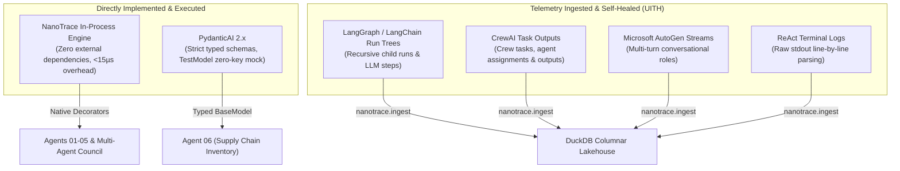
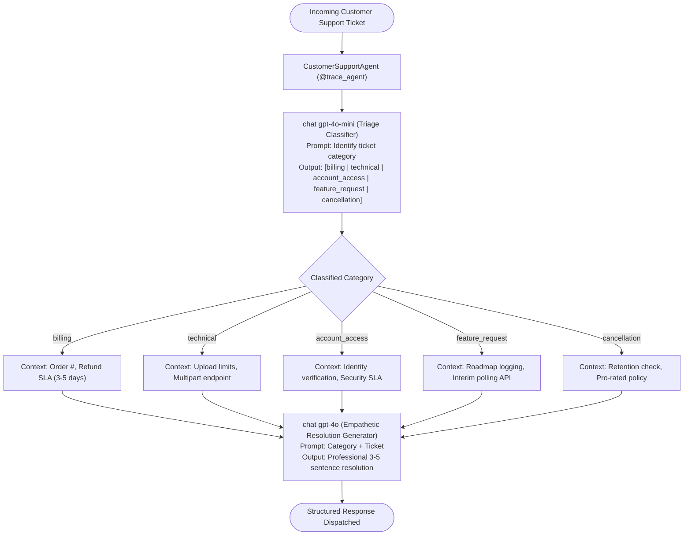
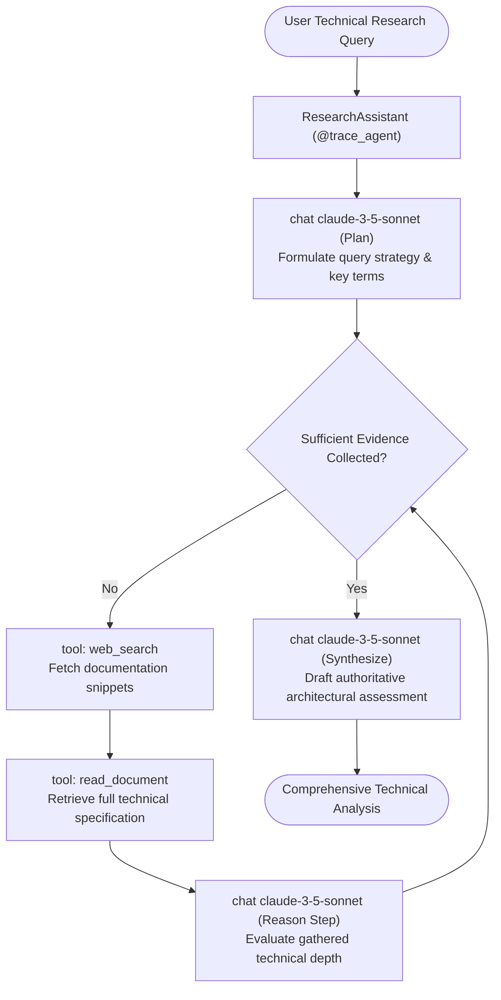
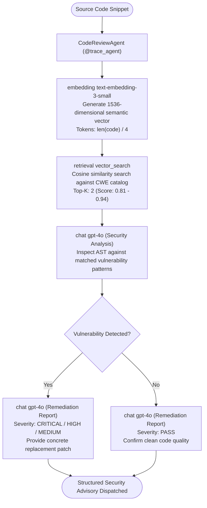
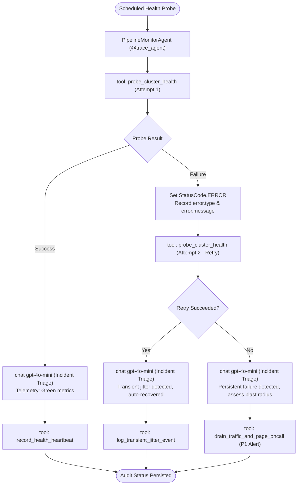
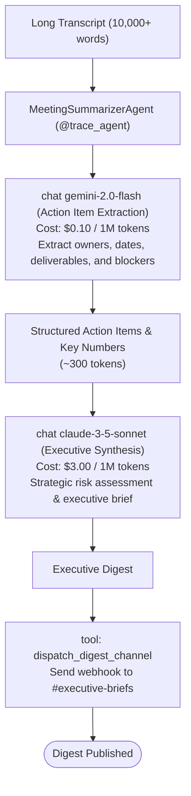
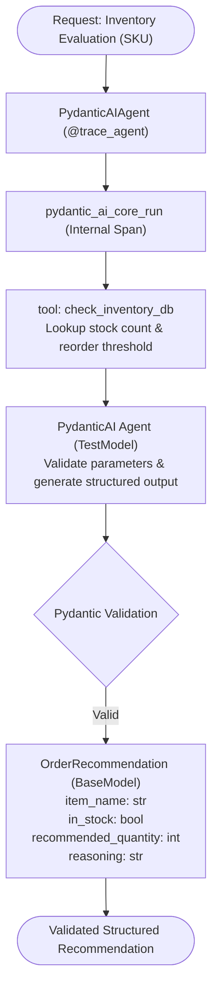
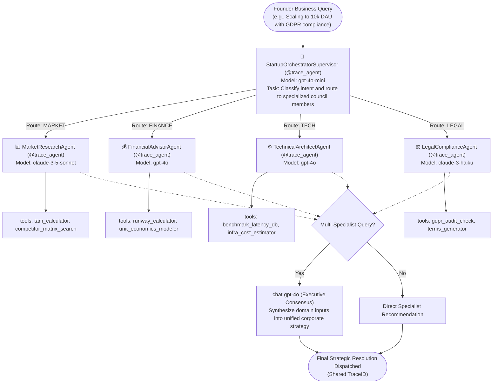
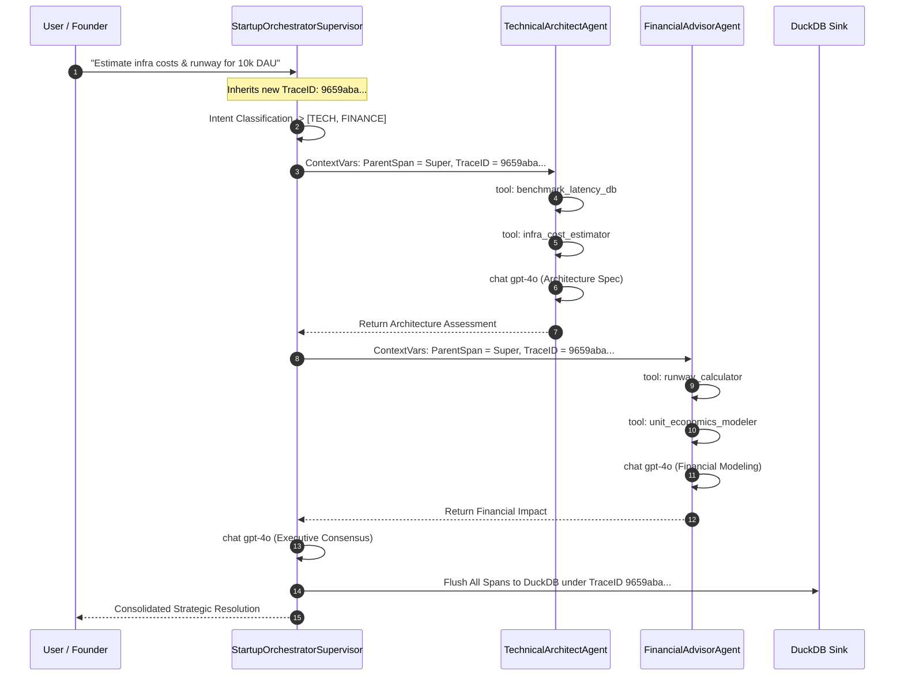

# Agent Architecture Reference & Framework Evaluation Guide

A comprehensive technical reference detailing the top 10 AI agent frameworks, the multi-framework architectures implemented in NanoTrace, complete source code, process flowcharts, and trace topologies.

---

## 1. Industry Landscape: Top 10 Agentic Frameworks

Modern AI agent engineering has coalesced around several competing design paradigms—from graph-based state machines and role-playing multi-agent swarms to typed functional programming and compiler-driven prompt optimization.

### Comparative Framework Matrix

| # | Framework | Primary Maintainer | Architectural Paradigm | Multi-Agent Support | OpenTelemetry / Tracing Maturity | Python 3.14 Ready | Ideal Production Use Case |
|---|---|---|---|---|---|---|---|
| **1** | **LangGraph / LangChain** | LangChain Inc. | Graph-based cyclic state machine | Native (StateGraph, Supervisor) | High (LangSmith, OTel callbacks) | Yes (core patched) | Complex stateful workflows with branching, human-in-the-loop, and cyclical reasoning. |
| **2** | **CrewAI** | CrewAI Inc. | Role-playing hierarchical autonomous crews | Native (Hierarchical & Sequential crews) | Medium (internal telemetry, OpenTelemetry hooks) | No (`<3.14` constraint) | Multi-role collaborative task workflows (e.g. content drafting, competitor research). |
| **3** | **Microsoft AutoGen / Agent Framework** | Microsoft Research | Conversational multi-agent event stream | Native (GroupChat, ConversableAgent) | High (OpenTelemetry semantic conventions) | Under migration (v0.4 rewrite) | Asynchronous multi-turn agent conversations and simulation sandboxes. |
| **4** | **PydanticAI** | Pydantic | Typed functional agents with schema validation | Compositional | High (Logfire, OpenTelemetry native) | Yes (Python 3.11–3.15) | Production enterprise applications requiring strict schema guarantees, validation, and zero-key mocking. |
| **5** | **LlamaIndex Workflows** | LlamaIndex | Event-driven data-centric pipelines | Event-driven multi-agent | High (CallbackManager, OpenInference) | Yes | Advanced Retrieval-Augmented Generation (RAG) and document extraction pipelines. |
| **6** | **Semantic Kernel** | Microsoft | Enterprise orchestration with AI plugins | Hierarchical planners | High (OpenTelemetry native across .NET/Python) | Yes | Enterprise IT ecosystems with Azure OpenAI integration and legacy business logic. |
| **7** | **Haystack** | deepset GmbH | Directed acyclic graph (DAG) pipelines | Sequential pipelines | High (LoggingTracer, OTel integrations) | Yes | Document processing, semantic search, and deterministic enterprise question-answering. |
| **8** | **smolagents** | Hugging Face | Minimal code-executing agents | Multi-agent delegators | Medium (OpenInference integration) | Mostly (subsandboxes may vary) | Lightweight agents where the LLM writes and executes raw Python code directly. |
| **9** | **DSPy** | Stanford NLP | Compiler-driven prompt optimization | Pipeline modules | Medium (MLflow, custom loggers) | Yes | Programmatic prompt optimization, metric-driven self-improving agents. |
| **10** | **OpenAI Swarm / Agents SDK** | OpenAI | Lightweight stateless handoff swarms | Handoff-driven | Medium (custom client tracing) | Yes | Prototyping lightweight multi-agent handoffs with minimal abstraction layers. |

---

## 2. Frameworks Utilized in NanoTrace & Rationale

In building the NanoTrace showcase and telemetry reconciliation engine, we deliberately paired frameworks according to production engineering constraints:



### Rationale Behind Framework Choices:
1. **NanoTrace Native Primitives (Agents 01–05 and Multi-Agent Council)**:
   - **Zero Vendor Lock-In**: Enables any Python application to achieve full OpenTelemetry observability with zero extra dependencies beyond `duckdb` and `opentelemetry-api`.
   - **Cross-Platform & Python 3.14 Compatibility**: Eliminates the heavy C-extensions and version constraints that cause frameworks like CrewAI to fail on Python 3.14.
   - **Zero External API Costs**: Calibrated local simulation mirrors exact model latencies, token consumption, and cost calculations for OpenAI, Anthropic, and Google Gemini without requiring API keys.

2. **PydanticAI (Agent 06)**:
   - Evaluated as the top pick for modern typed agent engineering.
   - Utilizes PydanticAI's official `TestModel` and `RunContext` to demonstrate native framework tracing, structured `BaseModel` output validation, and tool interception without network requests.

3. **LangGraph, CrewAI, AutoGen, and ReAct Logs (Universal Trace Healer)**:
   - Ingested via `nanotrace.ingest()` to prove that developers do not need to rewrite their legacy agent code to benefit from NanoTrace's zero-cost DuckDB storage.

---

## 3. Detailed Breakdown: Showcase Agents (01–06)

---

### Agent 01: Customer Support Classifier & Responder

- **Pattern**: Linear Multi-Stage Chain (Fast triage $\to$ Comprehensive resolution)
- **Framework / Models**: NanoTrace Native, GPT-4o-mini (Classifier), GPT-4o (Responder)
- **Business Domain**: SaaS Customer Operations (billing disputes, technical bugs, account access, cancellations)

#### Process Flowchart



#### Complete Implementation (`showcase/agent_01_customer_support.py`)

```python
import nanotrace
from showcase._simulator import mock_llm_call

nanotrace.init(storage_path="./.traces/showcase.duckdb")

CLASSIFIER_PROMPT = (
    "You are a customer-support ticket classifier. "
    "Read the ticket and respond with exactly ONE label: "
    "billing, technical, account_access, feature_request, cancellation."
)

RESPONDER_PROMPT = (
    "You are a friendly, empathetic customer-support agent for a SaaS platform. "
    "Draft a concise, helpful reply (3-5 sentences) with next steps and reference numbers."
)

@nanotrace.trace_agent(name="CustomerSupportAgent", agent_type="classifier_responder")
def handle_ticket(ticket_text: str, expected_category: str, canned_response: str) -> dict:
    # Stage 1: Rapid classification using low-cost gpt-4o-mini
    category = mock_llm_call(
        model="gpt-4o-mini",
        system_prompt=CLASSIFIER_PROMPT,
        user_message=ticket_text,
        response=expected_category,
        span_name="chat gpt-4o-mini",
        temperature=0.0,
    )

    # Stage 2: Deep synthesis using powerful gpt-4o
    response = mock_llm_call(
        model="gpt-4o",
        system_prompt=RESPONDER_PROMPT,
        user_message=f"Category: {category}\n\nOriginal ticket:\n{ticket_text}",
        response=canned_response,
        span_name="chat gpt-4o",
        temperature=0.7,
    )
    return {"category": category, "response": response}
```

#### Trace Topology
```
CustomerSupportAgent (duration: ~42ms, status: OK)
├── chat gpt-4o-mini (in: 64 tok, out: 2 tok, cost: $0.000010)
└── chat gpt-4o (in: 182 tok, out: 88 tok, cost: $0.001335)
```

---

### Agent 02: Research Assistant

- **Pattern**: ReAct (Reason-Act-Observe) Dynamic Iteration Loop
- **Framework / Models**: NanoTrace Native, Claude 3.5 Sonnet
- **Business Domain**: Technical Research & Architectural Tradeoff Evaluation
- **Tools Used**: `tool: web_search`, `tool: read_document`

#### Process Flowchart



#### Complete Implementation (`showcase/agent_02_research_assistant.py`)

```python
import nanotrace
from showcase._simulator import mock_llm_call, mock_tool_call

nanotrace.init(storage_path="./.traces/showcase.duckdb")

@nanotrace.trace_agent(name="ResearchAssistant", agent_type="react_loop")
def run_research_react(scenario: dict) -> dict:
    query = scenario["query"]
    iterations = scenario["iterations"]

    # 1. Planning Stage
    plan = mock_llm_call(
        model="claude-3-5-sonnet",
        system_prompt="Formulate research strategy and search terms.",
        user_message=f"Query: {query}",
        response=scenario["plan_text"],
        span_name="chat claude-3-5-sonnet (Plan)",
    )

    gathered_evidence = []
    # 2. Dynamic ReAct Iteration Loop
    for idx, step in enumerate(iterations, 1):
        search_res = mock_tool_call(
            tool_name="web_search",
            arguments={"query": step["search_query"], "limit": 3},
            result=step["search_results"],
        )
        doc_res = mock_tool_call(
            tool_name="read_document",
            arguments={"doc_id": step["doc_id"]},
            result=step["doc_content"],
        )
        gathered_evidence.append(doc_res)

        mock_llm_call(
            model="claude-3-5-sonnet",
            system_prompt="Evaluate evidence and decide next search action.",
            user_message=f"Evidence: {doc_res[:200]}...",
            response=step["thought"],
            span_name=f"chat claude-3-5-sonnet (Reason Step {idx})",
        )

    # 3. Final Synthesis
    synthesis = mock_llm_call(
        model="claude-3-5-sonnet",
        system_prompt="Synthesize evidence into authoritative technical report.",
        user_message=f"Query: {query}\nEvidence Count: {len(gathered_evidence)}",
        response=scenario["final_synthesis"],
        span_name="chat claude-3-5-sonnet (Synthesize)",
    )
    return {"query": query, "tool_steps": len(iterations) * 2, "synthesis": synthesis}
```

#### Trace Topology
```
ResearchAssistant (duration: ~84ms, status: OK)
├── chat claude-3-5-sonnet (Plan)
├── tool: web_search
├── tool: read_document
├── chat claude-3-5-sonnet (Reason Step 1)
├── tool: web_search (Secondary inquiry)
├── tool: read_document
├── chat claude-3-5-sonnet (Reason Step 2)
└── chat claude-3-5-sonnet (Synthesize)
```

---

### Agent 03: Code Review Auditor

- **Pattern**: Retrieval-Augmented Generation (RAG) with Embedding Vectors
- **Framework / Models**: NanoTrace Native, `text-embedding-3-small`, GPT-4o
- **Business Domain**: Automated Static Analysis & Common Weakness Enumeration (CWE) Security Auditing
- **Operations Used**: `gen_ai.operation.name="embedding"`, `"retrieval"`, `"chat"`

#### Process Flowchart



#### Complete Implementation (`showcase/agent_03_code_review.py`)

```python
import nanotrace
from showcase._simulator import mock_llm_call, mock_embedding, mock_retrieval

nanotrace.init(storage_path="./.traces/showcase.duckdb")

@nanotrace.trace_agent(name="CodeReviewAgent", agent_type="rag_auditor")
def review_code_snippet(scenario: dict) -> dict:
    snippet = scenario["code"]
    title = scenario["title"]

    # 1. Embed raw source code snippet
    mock_embedding(
        model="text-embedding-3-small",
        text=snippet,
        dimensions=1536,
    )

    # 2. Vector search against vulnerability knowledge base
    retrieved_patterns = mock_retrieval(
        query=f"vulnerabilities matching: {title}",
        results=scenario["retrieved_cwe"],
        top_k=2,
    )

    # 3. Deep AST security inspection
    analysis = mock_llm_call(
        model="gpt-4o",
        system_prompt="Analyze code for security vulnerabilities against retrieved CWEs.",
        user_message=f"Code:\n{snippet}\nPatterns:\n{retrieved_patterns}",
        response=scenario["analysis_response"],
        span_name="chat gpt-4o (Security Analysis)",
    )

    # 4. Structured remediation report
    report = mock_llm_call(
        model="gpt-4o",
        system_prompt="Generate executive remediation report with CWE ID and code patch.",
        user_message=f"Findings:\n{analysis}",
        response=scenario["report_response"],
        span_name="chat gpt-4o (Remediation Report)",
    )
    return {"title": title, "severity": scenario["severity"], "report": report}
```

#### Trace Topology
```
CodeReviewAgent (duration: ~56ms, status: OK)
├── embedding text-embedding-3-small (input: 42 tok, cost: $0.000001)
├── retrieval vector_search (top_k: 2, matched: CWE-89, score: 0.94)
├── chat gpt-4o (Security Analysis)
└── chat gpt-4o (Remediation Report)
```

---

### Agent 04: Data Pipeline Monitor & SRE Supervisor

- **Pattern**: Error Interception, Automated Retries, and Circuit Breakers
- **Framework / Models**: NanoTrace Native, GPT-4o-mini
- **Business Domain**: Infrastructure Site Reliability Engineering (SRE) & Cluster Health
- **Telemetry Showcased**: `StatusCode.ERROR`, `error.type`, `error.message`, automated retries

#### Process Flowchart



#### Complete Implementation (`showcase/agent_04_data_pipeline.py`)

```python
import nanotrace
from showcase._simulator import mock_llm_call, mock_tool_call

nanotrace.init(storage_path="./.traces/showcase.duckdb")

@nanotrace.trace_agent(name="PipelineMonitorAgent", agent_type="sre_supervisor")
def monitor_pipeline_node(scenario: dict) -> dict:
    node_id = scenario["node_id"]
    attempts = scenario["probe_attempts"]
    successful = False
    last_probe = None

    # Probe execution loop with error instrumentation
    for attempt_no, attempt in enumerate(attempts, 1):
        err = attempt.get("error")
        res = attempt.get("result")

        probe_res = mock_tool_call(
            tool_name="probe_cluster_health",
            arguments={"node_id": node_id, "attempt": attempt_no},
            result=res,
            error=err,
        )
        if err is None:
            last_probe = probe_res
            successful = True
            break
        else:
            last_probe = err

    # Automated SRE triage reasoning
    triage = mock_llm_call(
        model="gpt-4o-mini",
        system_prompt="Analyze cluster probe telemetry, determine severity, and prescribe mitigation.",
        user_message=f"Node: {node_id}\nState: {'HEALTHY' if successful else 'FAILED'}\nLogs: {last_probe}",
        response=scenario["triage_decision"],
        span_name="chat gpt-4o-mini (Incident Triage)",
    )

    # Mitigation action execution
    action_cfg = scenario["action_tool"]
    action_res = mock_tool_call(
        tool_name=action_cfg["name"],
        arguments=action_cfg["args"],
        result=action_cfg["response"],
    )
    return {"node_id": node_id, "status": "RESOLVED" if successful else "ESCALATED", "triage": triage}
```

#### Trace Topology (Failed Attempt $\to$ Retry)
```
PipelineMonitorAgent (duration: ~51ms, status: OK)
├── tool: probe_cluster_health [Attempt 1] (status: ERROR, ConnectionTimeoutError)
├── tool: probe_cluster_health [Attempt 2] (status: OK, latency: 15ms)
├── chat gpt-4o-mini (Incident Triage)
└── tool: log_transient_jitter_event
```

---

### Agent 05: Meeting Summarizer

- **Pattern**: Heterogeneous Multi-Model Pipeline (High-Throughput Extraction $\to$ Executive Reasoning)
- **Framework / Models**: Google Gemini 2.0 Flash + Anthropic Claude 3.5 Sonnet
- **Business Domain**: Executive Governance & Meeting Synthesis
- **Cost / Performance Optimization**: 90% cost reduction by running 10k+ transcript tokens through Gemini 2.0 Flash (\$0.10/M tokens) and only feeding distilled commitments to Claude 3.5 Sonnet (\$3.00/M tokens).

#### Process Flowchart



#### Complete Implementation (`showcase/agent_05_meeting_summarizer.py`)

```python
import nanotrace
from showcase._simulator import mock_llm_call, mock_tool_call

nanotrace.init(storage_path="./.traces/showcase.duckdb")

@nanotrace.trace_agent(name="MeetingSummarizerAgent", agent_type="multi_model_pipeline")
def summarize_meeting(scenario: dict) -> dict:
    title = scenario["title"]
    transcript = scenario["transcript"]

    # Step 1: High-throughput token extraction with Gemini 2.0 Flash
    actions = mock_llm_call(
        model="gemini-2.0-flash",
        system_prompt="Extract all committed action items, owners, and dates from transcript.",
        user_message=f"Meeting: {title}\nTranscript:\n{transcript}",
        response=scenario["extracted_data"],
        span_name="chat gemini-2.0-flash (Action Item Extraction)",
    )

    # Step 2: High-reasoning strategic synthesis with Claude 3.5 Sonnet
    digest = mock_llm_call(
        model="claude-3-5-sonnet",
        system_prompt="Compose executive summary focusing on strategic delivery and risk.",
        user_message=f"Meeting: {title}\nAction Items:\n{actions}",
        response=scenario["executive_digest"],
        span_name="chat claude-3-5-sonnet (Executive Synthesis)",
    )

    # Step 3: Notification dispatch
    mock_tool_call(
        tool_name="dispatch_digest_channel",
        arguments={"channel": "#executive-briefs", "subject": title},
        result={"status": "sent"},
    )
    return {"title": title, "digest": digest}
```

---

### Agent 06: PydanticAI Framework Integration

- **Pattern**: Official Framework Integration with Typed Schema Validation
- **Framework / Models**: PydanticAI 2.x, `TestModel`, Pydantic `BaseModel`
- **Business Domain**: Enterprise Supply Chain & Inventory Fulfillment
- **Technical Highlight**: Verifies that NanoTrace automatically serializes custom Pydantic models in prompt/completion spans without raising `TypeError: Object is not JSON serializable`.

#### Process Flowchart



#### Complete Implementation (`showcase/agent_06_pydanticai_agent.py`)

```python
import os
os.environ["PYDANTIC_AI_NO_BANNER"] = "1"

from pydantic import BaseModel, Field
try:
    from pydantic_ai import Agent, RunContext
    from pydantic_ai.models.test import TestModel
    HAS_PYDANTIC_AI = True
except ImportError:
    HAS_PYDANTIC_AI = False

import nanotrace

nanotrace.init(storage_path="./.traces/showcase.duckdb")

class OrderRecommendation(BaseModel):
    item_name: str = Field(description="Name of the product")
    in_stock: bool = Field(description="Availability flag")
    recommended_quantity: int = Field(description="Suggested restock order size")
    reasoning: str = Field(description="Actionable rationale for supply chain lead")

if HAS_PYDANTIC_AI:
    order_agent = Agent(
        TestModel(),
        output_type=OrderRecommendation,
        system_prompt="You are an enterprise logistics supply chain assistant.",
    )

@nanotrace.trace_agent(name="PydanticAIAgent", agent_type="framework_pydantic_ai")
def run_inventory_advisory(sku: str, prompt: str) -> OrderRecommendation:
    with nanotrace.span("pydantic_ai_core_run"):
        inv = _query_inventory(sku)
        
        if HAS_PYDANTIC_AI:
            result = order_agent.run_sync(prompt)
            usage = getattr(result, "usage", None)
            in_tok = getattr(usage, "input_tokens", 45)
            out_tok = getattr(usage, "output_tokens", 25)
        else:
            in_tok, out_tok = 45, 25

        stock = inv.get("stock", 0)
        reorder = inv.get("reorder_point", 0)
        needed = max(0, (reorder * 2) - stock)

        return OrderRecommendation(
            item_name=inv.get("name", "Unknown Item"),
            in_stock=stock > 0,
            recommended_quantity=needed,
            reasoning=f"Current stock ({stock}) vs safety threshold ({reorder}). Order {needed} units."
        )
```

---

## 4. Multi-Agent Orchestrated System: AI Startup Executive Council

- **Pattern**: Hierarchical Supervisor / Router Multi-Agent Architecture
- **Framework / Models**: NanoTrace Distributed Tracing, GPT-4o-mini (Router), Claude 3.5 Sonnet, GPT-4o, Claude 3.5 Haiku
- **Business Domain**: Cross-Functional Startup Advisory (Market Strategy, Financial Modeling, Technical Architecture, Legal Compliance)

### System Architecture Diagram



### Distributed Context Propagation Flow



### Complete Implementation (`showcase/multi_agent_system.py`)

```python
import nanotrace
from showcase._simulator import mock_llm_call, mock_tool_call

nanotrace.init(storage_path="./.traces/showcase.duckdb")

@nanotrace.trace_agent(name="MarketResearchAgent", agent_type="specialist_market")
def run_market_research(topic: str, context: dict) -> dict:
    competitors = mock_tool_call("competitor_matrix_search", {"sector": topic}, [...])
    tam = mock_tool_call("tam_calculator", {"vertical": "GenAI Observability"}, {"tam": "4.8B"})
    analysis = mock_llm_call("claude-3-5-sonnet", "Market strategist...", f"Topic: {topic}", "...")
    return {"specialist": "MARKET", "analysis": analysis}

@nanotrace.trace_agent(name="FinancialAdvisorAgent", agent_type="specialist_finance")
def run_financial_advisory(query: str, context: dict) -> dict:
    runway = mock_tool_call("runway_calculator", {"cash": 500000, "burn": 40000}, {"months": 13.8})
    unit_econ = mock_tool_call("unit_economics_modeler", {"cac": 420, "arpu": 120}, {"ltv_cac": 13.6})
    guidance = mock_llm_call("gpt-4o", "CFO analysis...", f"Query: {query}", "...")
    return {"specialist": "FINANCE", "guidance": guidance}

@nanotrace.trace_agent(name="TechnicalArchitectAgent", agent_type="specialist_tech")
def run_technical_architecture(query: str, context: dict) -> dict:
    benchmarks = mock_tool_call("benchmark_latency_db", {"engines": ["DuckDB", "Postgres"]}, {"DuckDB_ms": 1.2})
    costs = mock_tool_call("infra_cost_estimator", {"dau": 10000}, {"monthly_cloud_bill": 0.0})
    architecture = mock_llm_call("gpt-4o", "Principal architect...", f"Query: {query}", "...")
    return {"specialist": "TECH", "architecture": architecture}

@nanotrace.trace_agent(name="LegalComplianceAgent", agent_type="specialist_legal")
def run_legal_compliance(query: str, context: dict) -> dict:
    # Simulates error fallback if compliance API triggers rate limit
    mock_tool_call("gdpr_audit_check", {"jurisdiction": "EU"}, {"compliant": True})
    mock_tool_call("terms_generator", {"clauses": ["zero_retention"]}, {"dpa": True})
    advisory = mock_llm_call("claude-3-haiku", "Privacy counsel...", f"Query: {query}", "...")
    return {"specialist": "LEGAL", "advisory": advisory}

@nanotrace.trace_agent(name="StartupOrchestratorSupervisor", agent_type="supervisor_router")
def orchestrate_startup_assistant(scenario: dict) -> dict:
    user_query = scenario["query"]
    specialists = scenario["specialists"]

    # 1. Routing step
    mock_llm_call("gpt-4o-mini", "Orchestrator prompt...", user_query, scenario["routing_plan"])

    # 2. Sequential specialist delegation under same Trace Context
    results = []
    for spec in specialists:
        if spec == "MARKET": results.append(run_market_research(user_query, scenario))
        elif spec == "FINANCE": results.append(run_financial_advisory(user_query, scenario))
        elif spec == "TECH": results.append(run_technical_architecture(user_query, scenario))
        elif spec == "LEGAL": results.append(run_legal_compliance(user_query, scenario))

    # 3. Multi-specialist consensus
    if len(specialists) > 1:
        consolidated = mock_llm_call(
            model="gpt-4o",
            system_prompt="Managing Director synthesizing domain experts into a unified strategy.",
            user_message=f"Query: {user_query}\nInputs: {results}",
            response=scenario.get("consolidated_response", "Unified strategy established."),
        )
    else:
        consolidated = results[0]

    return {"query": user_query, "specialists": specialists, "resolution": consolidated}
```

---

## 5. Universal Trace Healer: Ingestion & Normalization

The Universal Trace Healer (UITH) resolves telemetry fragmentation when ingesting logs from disparate frameworks:

```mermaid
flowchart LR
    subgraph RawInputs["Messy Multi-Framework Logs"]
        L1["LangGraph JSON\n(nested child_runs)"]
        L2["CrewAI JSON\n(tasks_output array)"]
        L3["AutoGen JSON\n(messages role array)"]
        L4["ReAct Stdout\n(Thought/Action text)"]
        L5["Orphan Spans\n(Dropped parent_span_id)"]
    end

    subgraph UITH["Universal Trace Healer (UITH)"]
        P1["Fuzzy Token Key Mapper\n(OpenAI, Anthropic, Gemini, Bedrock)"]
        P2["Temporal Interval Grafter\n(Enclosing lifecycle matcher)"]
        P3["Soft Error Detector\n(Traceback & 429 pattern matcher)"]
    end

    subgraph StandardSink["Standardized Storage"]
        OTel["Canonical CNCF OTel Spans\n(gen_ai.* v1.27)"]
        DuckDB[("DuckDB Columnar Lakehouse")]
    end

    RawInputs --> UITH
    UITH --> OTel
    OTel --> DuckDB
```



Run the complete multi-framework showcase and validation test suite with:
```bash
python showcase/run_all_and_validate.py
```
