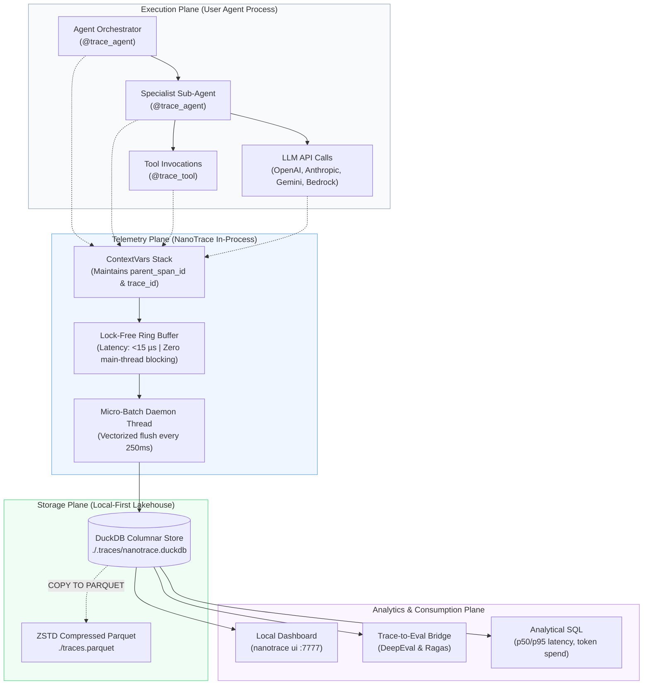
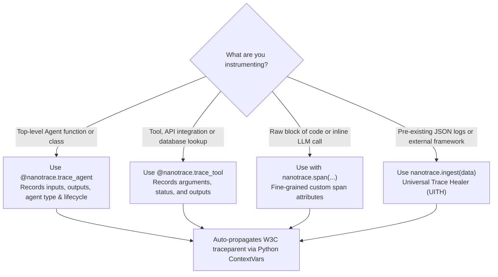
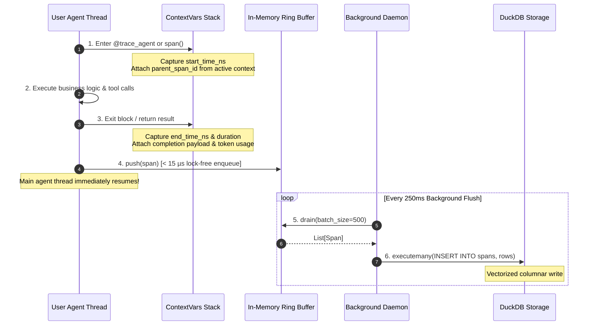
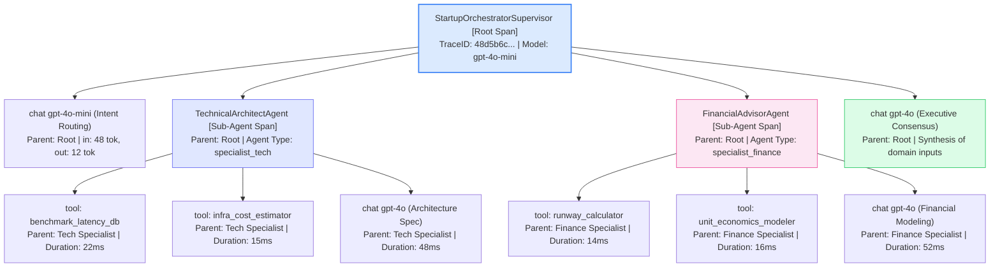
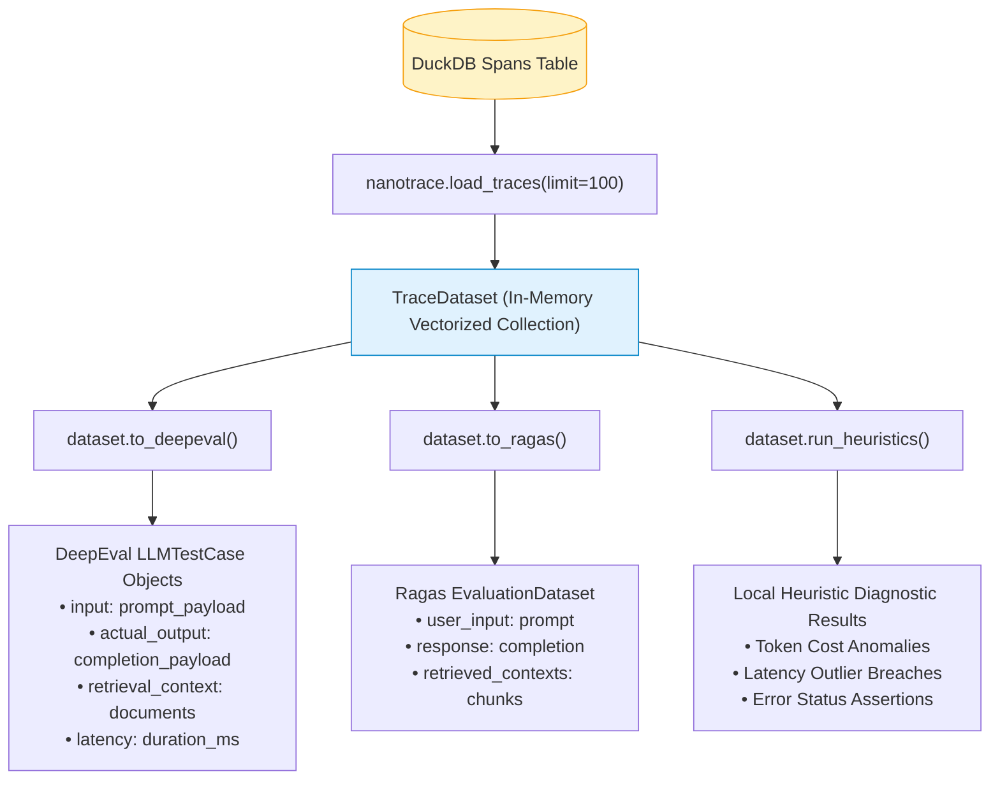

# NanoTrace User Manual: Architecture, Workflows & Infographics

The DuckDB of AI Observability — An in-process, zero-overhead OpenTelemetry tracing and evaluation engine for AI agents and LLMs.

---

## 1. System Architecture & End-to-End Dataflow

NanoTrace eliminates external telemetry infrastructure by embedding directly inside your Python application process. Traces are enqueued into an in-memory ring buffer in microseconds, flushed asynchronously by a daemon thread, and stored in an embedded DuckDB columnar file or native Parquet.



---

## 2. Decision Matrix: Choosing the Right Tracing API



---

## 3. Span Lifecycle: From Creation to Columnar Storage

The following sequence diagram traces the complete lifecycle of a single span—demonstrating how main-thread execution overhead is isolated to under 15 microseconds:



---

## 4. Multi-Agent Orchestration & Trace Hierarchy

In a multi-agent system, multiple specialized agents execute sequentially or in parallel. NanoTrace automatically nests child spans under their calling agent's span using Python `contextvars`, guaranteeing that all spans share a single root `trace_id`.



---

## 5. Universal Trace Healer: Ingesting Non-Standard Telemetry

When working with external frameworks (LangGraph, CrewAI, AutoGen) or unstructured logs, telemetry often arrives with missing parent links, fragmented token keys, or unhandled exceptions. The Universal Trace Healer (UITH) automatically repairs these logs:

```mermaid
flowchart LR
    subgraph DirtyLogs["Chaotic Ingestion Payloads"]
        LangGraph["LangGraph Run Tree\n(nested child_runs)"]
        CrewAI["CrewAI Task Dump\n(tasks_output array)"]
        AutoGen["AutoGen Message Array\n(role/content turns)"]
        ReAct["ReAct Stdout Log\n(Thought/Action text)"]
        Orphans["Disconnected Spans\n(Lost parent_span_id)"]
    end

    subgraph HealerPipeline["TraceHealer Normalization Stages"]
        P1["1. Parser & Deconstructor\nState machine & JSON unwrapper"]
        P2["2. Fuzzy Token Normalizer\nMap OpenAI, Anthropic, Gemini, Bedrock"]
        P3["3. Temporal Interval Grafter\nMatch orphan timestamps to enclosing parent"]
        P4["4. Soft Error Detector\nScan return values for tracebacks & 429s"]
    end

    subgraph Canonical["Standardized Sink"]
        OTelSpans["CNCF OpenTelemetry GenAI v1.27 Spans"]
        DuckDBLakehouse[("DuckDB Storage")]
    end

    DirtyLogs --> P1
    P1 --> P2
    P2 --> P3
    P3 --> P4
    P4 --> OTelSpans
    OTelSpans --> DuckDBLakehouse
```



### Key Healer Capabilities:
1. **Temporal Interval Grafting**: If a child span loses its `parent_span_id` (e.g. across `ThreadPoolExecutor` threads), NanoTrace identifies the parent span active during the child's `[start_time_ns, end_time_ns]` window and grafts it automatically.
2. **Fuzzy Token Normalization**: Resolves vendor-specific token structures (`prompt_tokens`, `input_tokens`, `prompt_token_count`, `inputTokenCount`) into canonical `gen_ai.usage.input_tokens`.
3. **Soft Error Detection**: Inspects tool return strings for exceptions and HTTP errors (`404 Not Found`, `429 Rate Limit`, `Traceback`), marking the span with `StatusCode.ERROR` even if caught in user code.

---

## 6. Trace-to-Eval Pipeline Dataflow

Observability data in NanoTrace feeds directly into offline and real-time evaluation frameworks:



---

## 7. Interactive Dashboard: Component Architecture

The local web dashboard (`nanotrace ui`) provides zero-dependency visual debugging:

```
┌─────────────────────────────────────────────────────────────────────────────┐
│ NanoTrace v0.1.0  [ 🦆 showcase.duckdb (262 spans) ▾ ]  [☀️/🌙]  [Refresh]   │
├─────────────────┬──────────────────┬──────────────────┬─────────────────────┤
│ Total Traces: 51│ Total Spans: 262 │ Tokens: 16,462   │ Est. Spend: $0.0625 │
├─────────────────┴──────────────────┴──────────────────┴─────────────────────┤
│ TRACES EXPLORER │ WATERFALL TIMELINE RULER & SPAN INSPECTION                │
│ ┌─────────────┐ │ 0ms               25ms               50ms            75ms │
│ │Search: [   ]│ │ ├───────────────────┼──────────────────┼────────────────┤ │
│ ├─────────────┤ │ ▼ StartupOrchestratorSupervisor                 (78.2 ms) │
│ │StartupSuper │ │   ├── chat gpt-4o-mini (Router)                 (12.4 ms) │
│ │Duration:78ms│ │   ▼ TechnicalArchitectAgent                     (42.1 ms) │
│ │Spans: 7     │ │     ├── tool: benchmark_latency_db              (22.0 ms) │
│ │Status: OK   │ │     └── chat gpt-4o (Architecture Spec)         (18.5 ms) │
│ ├─────────────┤ │                                                           │
│ │CodeReview   │ │ SPAN DETAIL DRAWER: tool: benchmark_latency_db            │
│ │Duration:56ms│ │ • Provider: custom  • Model: DuckDB  • Status: OK         │
│ │Status: OK   │ │ • Arguments: {"engines": ["DuckDB", "Postgres"]}          │
│ └─────────────┘ │ • Output: {"DuckDB_p50_ms": 1.2, "PostgreSQL_p50_ms": 142}│
└─────────────────┴───────────────────────────────────────────────────────────┘
```

---

## 8. Command-Line Reference

| Command | Action | Key Options |
|---|---|---|
| `nanotrace ui` | Start the local interactive dashboard | `--port 7777`, `--host 127.0.0.1`, `--db <path>` |
| `nanotrace demo` | Run all 6 showcase agents + validator | `--ui` (auto-launch browser), `--port 7777` |
| `nanotrace stats` | Print aggregate metrics table | `--db <path>` |
| `nanotrace query` | Execute analytical SQL on spans | `--db <path>`, `<SQL string>` |
| `nanotrace export` | Export traces to compressed Parquet | `--output traces.parquet`, `--db <path>` |
| `nanotrace ingest` | Self-heal and ingest external JSON logs | `<file_path>`, `--db <path>` |
| `nanotrace eval` | Run zero-cost heuristic diagnostics | `--db <path>` |

---

## 9. Quick Verification Test

To verify your installation and generate a complete sample database of traces across all 6 agent patterns:

```bash
# 1. Run the showcase suite and automated validator
python showcase/run_all_and_validate.py

# 2. Launch the interactive dashboard
nanotrace ui --port 7777
```

Navigate to `http://127.0.0.1:7777` to inspect live waterfalls, switch between databases, and review token metrics.
