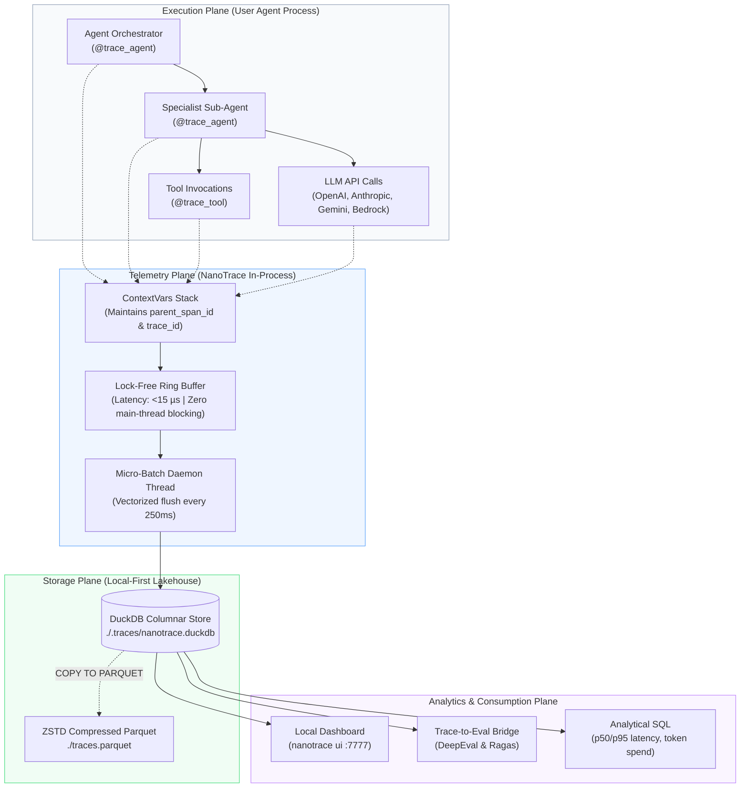
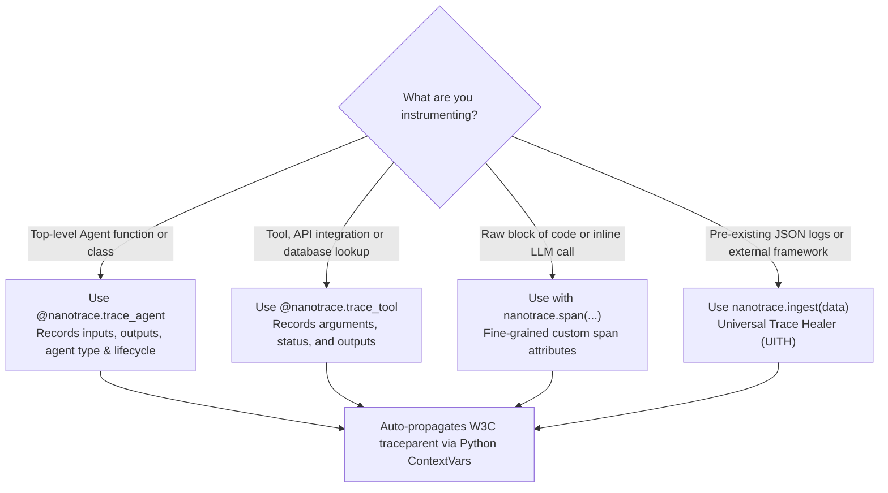
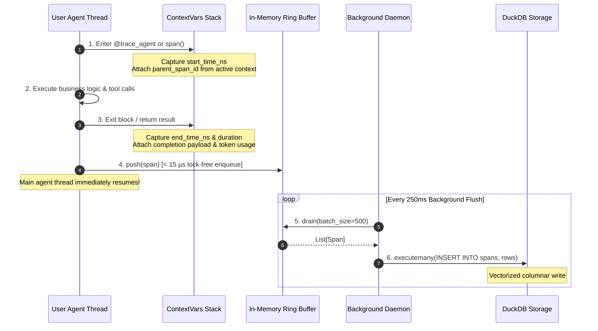
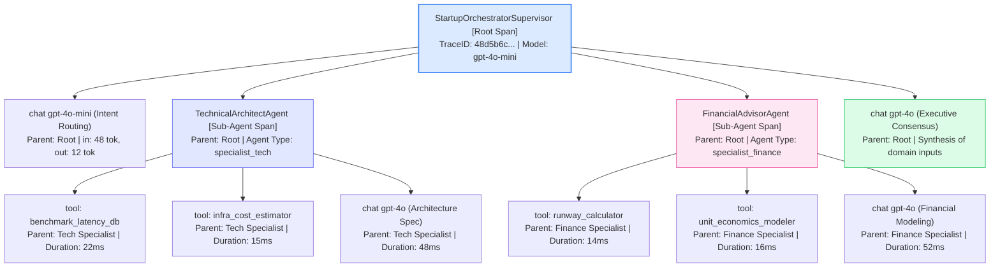
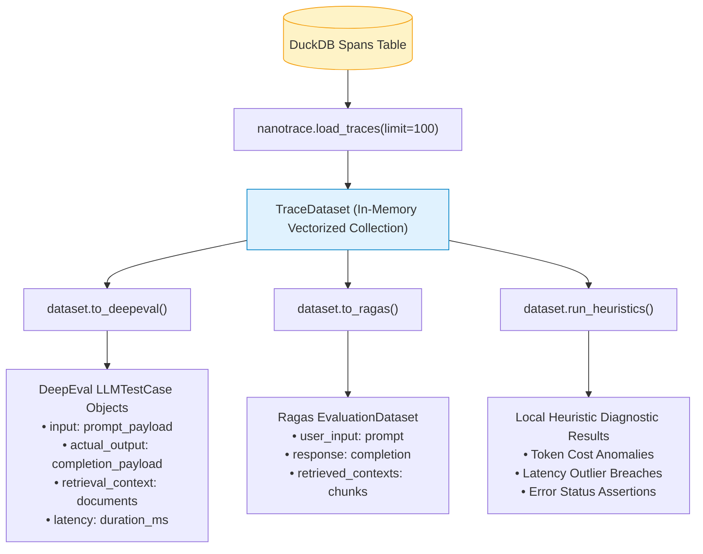

# NanoTrace User Manual: Architecture, Workflows & Infographics

The DuckDB of AI Observability — An in-process, zero-overhead OpenTelemetry tracing and evaluation engine for AI agents and LLMs.

---

## 0. Architectural Perspective & Infographic: AI Agent Observability & Evaluation Pipelines

To understand what NanoTrace is "in and around," consider how modern autonomous agent engineering departs from traditional software development. Traditional web services feature deterministic HTTP request/response flows. In contrast, **autonomous AI agents** loop continuously, decompose complex prompts into execution plans, delegate to specialized sub-agents, call external tools, stream tokens from non-deterministic LLMs, and recover from failures dynamically.

NanoTrace provides a **3-Act closed-loop architecture** modeled after high-velocity continuous integration and delivery systems:

```
====================================================================================================
                        AI AGENT OBSERVABILITY & EVALUATION PIPELINES
====================================================================================================

ACT 1: THE AI AGENT AUTONOMOUS EXECUTION LIFECYCLE
----------------------------------------------------------------------------------------------------
  [ ⟲ Autonomous Multi-Turn Reflection Loop: Re-plans when tools error or return partial results ]
                                                  ▲                                       │
  ┌───────────────────────┐   ┌───────────────────┴───┐   ┌───────────────────────────────┴────────┐
  │ IN-PROCESS CONTEXT    │   │ REASONING DAG         │   │ TOOLS, LLMS & SYNTHESIS                │
  │ [User Prompt]         │ ➔ │ [ReAct Planner]       │ ➔ │ [Tool Calls] (@trace_tool)             │
  │       │               │   │       │               │   │       │                                │
  │ [Agent Host]          │   │ [Sub-Agent Council]   │   │ [LLM Inference] (4o/Claude/Gemini)     │
  │ (@trace_agent)        │   │ (Parallel delegation) │   │       │                                │
  │                       │   │                       │   │ [Output Synthesis] (Seals Root Span)   │
  └───────────────────────┘   └───────────────────────┘   └────────────────────────────────────────┘

ACT 2: TELEMETRY INGESTION PIPELINE (TRADITIONAL SAAS VS. NANOTRACE)
----------------------------------------------------------------------------------------------------
  [TRADITIONAL SAAS]  Agent Turn ➔ Blocking JSON ➔ [⚠️ Blocking HTTP POST (20-80ms)] ➔ Cloud Cluster
                      (High Latency • $500-$2,000/mo Ingestion Costs • Third-Party Data Egress Risk)
                                                    VS
  [NANOTRACE MODEL]   Agent Turn ➔ Lock-Free Ring Buffer (< 15 µs) ➔ Parallel Self-Healing:
                                                                     ├─ Universal Trace Healer (UITH)
                                                                     ├─ Distributed Grafter (Orphans)
                                                                     └─ Soft Error Detector
                                                                   ➔ Embedded DuckDB Lakehouse ($0.00)

ACT 3: LET'S SEE IN DETAIL: THE OBSERVABILITY & EVALUATION INFINITY LOOP ( ∞ )
----------------------------------------------------------------------------------------------------
           OBSERVE (Runtime Tracing)               DUCKDB LAKEHOUSE              EVALUATE (Continuous Quality)
     ┌───────────────────────────────────┐      ┌────────────────────┐     ┌───────────────────────────────────┐
     │ 1. Agent Application Code         │ ────▶│  🦆 Embedded       │────▶│ 1. TraceDataset Builder           │
     │ 2. Async ContextVars Engine       │      │     DuckDB         │     │ 2. Deterministic Heuristics       │
     │ 3. Universal Trace Healer (UITH)  │      │  nanotrace.duckdb  │     │ 3. LLM-as-a-Judge (DeepEval/Ragas)│
     │    [🚨 Self-Healed in 0.18ms!]    │      │  Parquet Storage   │     │    [🚨 Regression Detected <0.70!]│
     │ 4. Lock-Free Ring Buffer (50k)    │      │  Dashboard (:7777) │     │ 4. CI/CD Quality Gate (Blocks PR) │
     └───────────────────────────────────┘      └────────────────────┘     └───────────────────────────────────┘
                       ▲                                                                     │
                       └──────────── [ Prompt & Architecture Optimization Loop ] ────────────┘
====================================================================================================
```

### The Three Acts Explained:
1. **Act 1: The AI Agent Execution Lifecycle** — Captures where in-process tracing hooks into non-deterministic execution loops without interrupting agent thought cycles.
2. **Act 2: The Core Mechanism / Pipeline** — Contrasts the legacy 20–80ms HTTP network blocking penalty and $100s–$1,000s cloud SaaS invoices against NanoTrace's `< 15 µs` in-memory ring buffer and embedded DuckDB storage.
3. **Act 3: The Observability & Evaluation Infinity Loop ($\infty$)** — The operational closed loop. Production runtime traces captured on the **OBSERVE** wing continuously stream into the **DuckDB Lakehouse Hub**, where they are transformed into test fixtures on the **EVALUATE** wing. Regressions caught by DeepEval or Ragas immediately trip CI/CD gates, feeding prompt and topology refinements back into agent code.

---

## 1. System Architecture & End-to-End Dataflow

NanoTrace eliminates external telemetry infrastructure by embedding directly inside your Python application process. Traces are enqueued into an in-memory ring buffer in microseconds, flushed asynchronously by a daemon thread, and stored in an embedded DuckDB columnar file or native Parquet.



---

## 2. Decision Matrix: Choosing the Right Tracing API



---

## 3. Span Lifecycle: From Creation to Columnar Storage

The following sequence diagram traces the complete lifecycle of a single span—demonstrating how main-thread execution overhead is isolated to under 15 microseconds:



---

## 4. Multi-Agent Orchestration & Trace Hierarchy

In a multi-agent system, multiple specialized agents execute sequentially or in parallel. NanoTrace automatically nests child spans under their calling agent's span using Python `contextvars`, guaranteeing that all spans share a single root `trace_id`.



---

## 5. Universal Trace Healer: Ingesting Non-Standard Telemetry

When working with external frameworks (LangGraph, CrewAI, AutoGen) or unstructured logs, telemetry often arrives with missing parent links, fragmented token keys, or unhandled exceptions. The Universal Trace Healer (UITH) automatically repairs these logs:

```mermaid
flowchart LR
    subgraph DirtyLogs["Chaotic Ingestion Payloads"]
        LangGraph["LangGraph Run Tree\n(nested child_runs)"]
        CrewAI["CrewAI Task Dump\n(tasks_output array)"]
        AutoGen["AutoGen Message Array\n(role/content turns)"]
        ReAct["ReAct Stdout Log\n(Thought/Action text)"]
        Orphans["Disconnected Spans\n(Lost parent_span_id)"]
    end

    subgraph HealerPipeline["TraceHealer Normalization Stages"]
        P1["1. Parser & Deconstructor\nState machine & JSON unwrapper"]
        P2["2. Fuzzy Token Normalizer\nMap OpenAI, Anthropic, Gemini, Bedrock"]
        P3["3. Temporal Interval Grafter\nMatch orphan timestamps to enclosing parent"]
        P4["4. Soft Error Detector\nScan return values for tracebacks & 429s"]
    end

    subgraph Canonical["Standardized Sink"]
        OTelSpans["CNCF OpenTelemetry GenAI v1.27 Spans"]
        DuckDBLakehouse[("DuckDB Storage")]
    end

    DirtyLogs --> P1
    P1 --> P2
    P2 --> P3
    P3 --> P4
    P4 --> OTelSpans
    OTelSpans --> DuckDBLakehouse
```



### Key Healer Capabilities:
1. **Temporal Interval Grafting**: If a child span loses its `parent_span_id` (e.g. across `ThreadPoolExecutor` threads), NanoTrace identifies the parent span active during the child's `[start_time_ns, end_time_ns]` window and grafts it automatically.
2. **Fuzzy Token Normalization**: Resolves vendor-specific token structures (`prompt_tokens`, `input_tokens`, `prompt_token_count`, `inputTokenCount`) into canonical `gen_ai.usage.input_tokens`.
3. **Soft Error Detection**: Inspects tool return strings for exceptions and HTTP errors (`404 Not Found`, `429 Rate Limit`, `Traceback`), marking the span with `StatusCode.ERROR` even if caught in user code.

---

## 6. Trace-to-Eval Pipeline Dataflow

Observability data in NanoTrace feeds directly into offline and real-time evaluation frameworks:



---

## 7. Interactive Dashboard: Dual-Audience Lenses & Standalone Capsule

The local web dashboard (`nanotrace ui`) provides zero-dependency visual debugging with instant switching between executive and engineering lenses:

* **👔 Business Lens**: Tailored for Product Managers, executives, and non-engineers. Features high-level scorecards (operational health, turnaround time, economic spend, token consumption), clean conversational user objective cards, and plain-English tool action summaries.
* **🛠️ Hacker Lens**: Tailored for AI engineers and performance specialists. Features millisecond/microsecond waterfall timeline Gantt charts with adaptive unit scaling (`µs` vs `ms`), hierarchical span trees with parent-child indentation, and comprehensive OpenTelemetry GenAI inspection drawers.
* **📦 1-Click Standalone Capsule Export (`.ntrace.html`)**: With a single click, package the entire execution trace into a self-contained offline HTML file that opens anywhere without Python, Docker, or server infrastructure.

```
┌─────────────────────────────────────────────────────────────────────────────┐
│ NanoTrace v0.1.0  [ 🦆 showcase.duckdb ▾ ] [👔 Business | 🛠️ Hacker] [☀️/🌙]│
├─────────────────┬──────────────────┬──────────────────┬─────────────────────┤
│ Total Traces: 51│ Total Spans: 262 │ Tokens: 16,462   │ Est. Spend: $0.0625 │
├─────────────────┴──────────────────┴──────────────────┴─────────────────────┤
│ TRACES EXPLORER │ DUAL-AUDIENCE WORKSPACE & STANDALONE CAPSULE EXPORT       │
│ ┌─────────────┐ │ [📥 Export Capsule (.html)] [🛡️ Run Evals] [📋 Copy ID]   │
│ │Search: [   ]│ │ ───────────────────────────────────────────────────────── │
│ ├─────────────┤ │ EXECUTIVE SCORECARD (Business Lens):                      │
│ │StartupSuper │ │ • Status: Operational OK  • Latency: 78.2 ms              │
│ │Duration:78ms│ │ • LLM Calls: 4 calls      • Spend: $0.0028                │
│ │Spans: 7     │ │                                                           │
│ │Status: OK   │ │ 👤 User Objective: "Analyze market expansion in APAC"     │
│ ├─────────────┤ │ 🛠️ Tool Action: tool: fetch_market_intelligence (22 ms)   │
│ │CodeReview   │ │ 🧠 AI Deliberation: gpt-4o (Strategic Synthesis)          │
│ │Duration:56ms│ │ 🎯 Final Deliverable: "APAC expansion strategy ready..."  │
│ └─────────────┘ │                                                           │
└─────────────────┴───────────────────────────────────────────────────────────┘
```

---

## 8. NanoShield: Active In-Process Circuit Breakers & Runtime Guardrails

NanoShield extends tracing from passive observability into **active, sub-microsecond in-process protection**. Circuit breakers evaluate safety policies directly inside the agent execution thread before and after each node runs.

```
┌─────────────────────────────────────────────────────────────────────────────────┐
│                      NANOSHIELD RUNTIME CIRCUIT BREAKERS                        │
├──────────────────────┬──────────────────────┬───────────────────────────────────┤
│ Breaker Policy       │ Trigger Condition    │ In-Process Action Taken           │
├──────────────────────┼──────────────────────┼───────────────────────────────────┤
│ MaxLoopBreaker       │ Tool calls >= Limit  │ Intercept runaway recursive loops │
│ BudgetCapBreaker     │ Spend >= Max USD     │ Halt before cloud bill escalates  │
│ MaxTokenBreaker      │ Tokens >= Threshold  │ Prevent context overflow collapse │
│ PIIRedaction         │ Key/SSN/Email regex  │ In-place mask or strict blocking  │
│ TimeoutBreaker       │ Duration >= SLA (s)  │ Hard cutoff on hanging agent jobs │
└──────────────────────┴──────────────────────┴───────────────────────────────────┘
```

### Python API Integration

```python
import nanotrace
from nanotrace.guardrails import (
    MaxLoopBreaker,
    BudgetCapBreaker,
    PIIRedaction,
    TimeoutBreaker,
)
from nanotrace.exceptions import CircuitBreakerTrip

# Initialize global guardrails across all traces
nanotrace.init(
    circuit_breakers=[
        MaxLoopBreaker(limit=5),
        BudgetCapBreaker(max_trace_usd=1.00),
        PIIRedaction(action="redact"),
        TimeoutBreaker(timeout_seconds=30.0),
    ]
)

# Apply specific breakers to individual tools
@nanotrace.trace_tool(circuit_breakers=[MaxLoopBreaker(limit=2)])
def call_weather_api(city: str):
    return fetch_weather(city)
```

When tripped, NanoShield automatically marks the span as `StatusCode.ERROR`, tags `nanotrace.shield.tripped=True`, logs the exact breach metrics, and raises a catchable `CircuitBreakerTrip` exception.

---

## 9. Time-Travel Agent Debugger & 1-Click "Replay & Fork" Playground

Debugging non-deterministic agents often requires tedious manual repro steps and wasted token budgets. The **Time-Travel Debugger** allows engineers to rewind an execution trace to any intermediate decision node, modify prompts or swap models, and re-execute a live forked branch in-process.

```
Original Trace Lineage:
[User Objective] ➔ [Planner Node] ➔ [Tool: Fetch Data] ➔ [Synthesizer] (Broken/Costly)
                         │
                         ▼ (1-Click "Replay & Fork")
Forked Trace Branch:     └─ [Rewritten Guidance] ➔ [gpt-4o-mini] ➔ [Synthesizer] (Fixed, 90% Cheaper)
```

### Key Capabilities:
* **Ancestry Context Preservation**: Reuses cached outputs from all upstream nodes, avoiding redundant LLM consultations and saving up to 90% in token spend.
* **1-Click Waterfall Forking**: Click **`⏱️ Fork & Replay`** directly from any waterfall bar in the Hacker Lens or span drawer.
* **Model & Temperature Overrides**: Test how `claude-3-5-sonnet`, `gpt-4o-mini`, or `gemini-2.0-flash` perform on identical upstream state.
* **Side-by-Side Execution Diff**: Review duration delta, token consumption, cost savings, and response diffs in real time.

---

## 10. Trace-to-Gold Regression Suite & Golden Dataset Factory

Production traces are rich in actual user intent, tool calls, and edge cases. NanoTrace allows engineering teams to convert production telemetry into curated **Golden Evaluation Datasets** and run automated A/B prompt regression matrices.

```
[ Production Traces (DuckDB) ] ──▶ [ 🌟 Save as Golden ] ──▶ [ Golden Dataset Hub ]
                                                                       │
┌──────────────────────────────────────────────────────────────────────┘
▼
[ Prompt Regression Matrix ]
  ├─ Variant A (Baseline Prompt / GPT-4o)
  ├─ Variant B (Candidate Prompt / GPT-4o-Mini)
  └─ Parallel Scoring Engine (Token Jaccard & Levenshtein Ratio)
        │
        ▼
[ Automated CI/CD Gate ] ──▶ Pass Rate ≥ 80%? ──▶ Exit 0 (PASS) / Exit 1 (BREACH)
```

### Key Features:
* **1-Click Golden Extraction**: Click **`🌟 Save as Golden`** directly in the span inspection drawer to save input prompt payloads and verified outputs into DuckDB (`golden_cases` table).
* **Multi-Threaded Parallel Regression Matrix**: Run A/B test matrices comparing candidate prompt instructions or model variants against baseline completions across full golden datasets.
* **Zero-Cost Local Scoring**: Computes token-level Jaccard similarity and Levenshtein distance locally in microseconds without requiring paid judge model API calls.
* **Pareto Status Classification**: Automatically marks each evaluated case as `✅ IMPROVED`, `❌ REGRESSED`, or `➖ UNCHANGED`.

---

## 11. Automated CI/CD Quality Gate CLI (`nanotrace test`)

Integrate continuous AI evaluation directly into GitHub Actions, GitLab CI, or pre-commit hooks to prevent prompt regressions from hitting production:

```bash
# Run automated regression gate against a golden dataset with an 80% pass threshold
nanotrace test --dataset financial_benchmarks --fail-under 0.80

# List all curated golden datasets
nanotrace golden list

# Export golden dataset to JSONL for portability
nanotrace golden export --dataset financial_benchmarks --output cases.jsonl

# Save a golden case directly from a CLI trace
nanotrace golden save --span-id <span_id> --dataset prod_gold --name "Tax Edge Case"
```

* **Deterministic CI/CD Integration**: Exits with code `0` when `pass_rate >= fail_under`, and exits with code `1` on regression breach, immediately failing pipeline builds.

---

## 12. Command-Line Reference

| Command | Action | Key Options |
|---|---|---|
| `nanotrace run <script.py>` | Zero-code auto-pilot runner: executes and traces any script with `< 15 µs` overhead | `python <script.py>`, `--db <path>`, `--ui`, `--capsule` |
| `nanotrace export-capsule <id>` | Export single self-contained standalone HTML capsule | `-o <path.html>`, `--db <path>`, `--open` |
| `nanotrace test --dataset <name>` | Automated CI/CD quality gate: runs prompt regression matrix; exits code 0/1 | `--dataset <name>`, `--fail-under <pct>`, `--db <path>` |
| `nanotrace golden list` | List all curated golden evaluation datasets and case counts | `--db <path>` |
| `nanotrace golden save` | Extract and save a golden benchmark case from a recorded trace or span | `--span-id <id>`, `--dataset <name>`, `--name <title>` |
| `nanotrace golden export` | Export a golden dataset to a portable JSONL benchmark file | `--dataset <name>`, `--output <file.jsonl>` |
| `nanotrace ui` | Start the local interactive dashboard | `--port 7777`, `--host 127.0.0.1`, `--db <path>` |
| `nanotrace demo` | Run all 6 showcase agents + validator | `--ui` (auto-launch browser), `--port 7777` |
| `nanotrace stats` | Print aggregate metrics table | `--db <path>` |
| `nanotrace query` | Execute analytical SQL on spans | `--db <path>`, `<SQL string>` |
| `nanotrace export` | Export traces to compressed Parquet or HTML capsule | `--output traces.parquet`, `--format html`, `--db <path>` |
| `nanotrace ingest` | Self-heal and ingest external JSON logs | `<file_path>`, `--db <path>` |
| `nanotrace eval` | Run zero-cost heuristic diagnostics | `--db <path>` |

---

## 13. Quick Verification Test

To verify your installation and generate a complete sample database of traces across all 6 agent patterns:

```bash
# 1. Run the showcase suite and automated validator
python showcase/run_all_and_validate.py

# 2. Launch the interactive dashboard
nanotrace ui --port 7777
```

Navigate to `http://127.0.0.1:7777` to inspect live waterfalls, switch between databases, and review token metrics.
