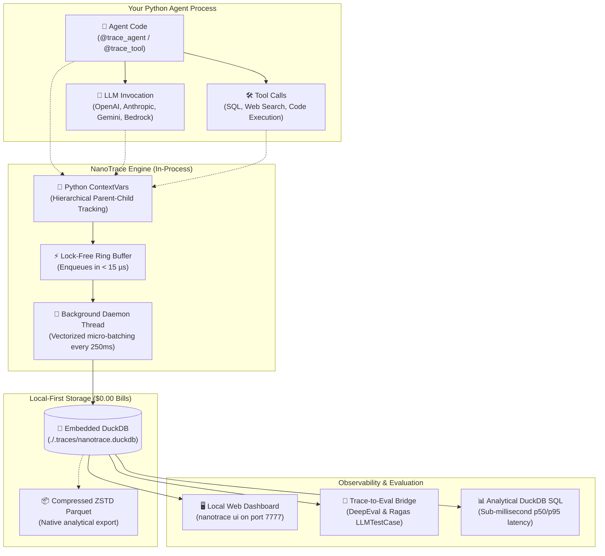
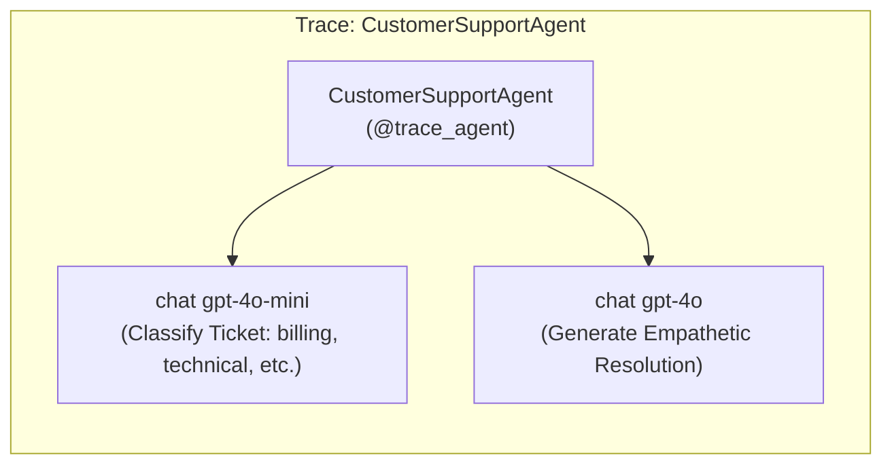
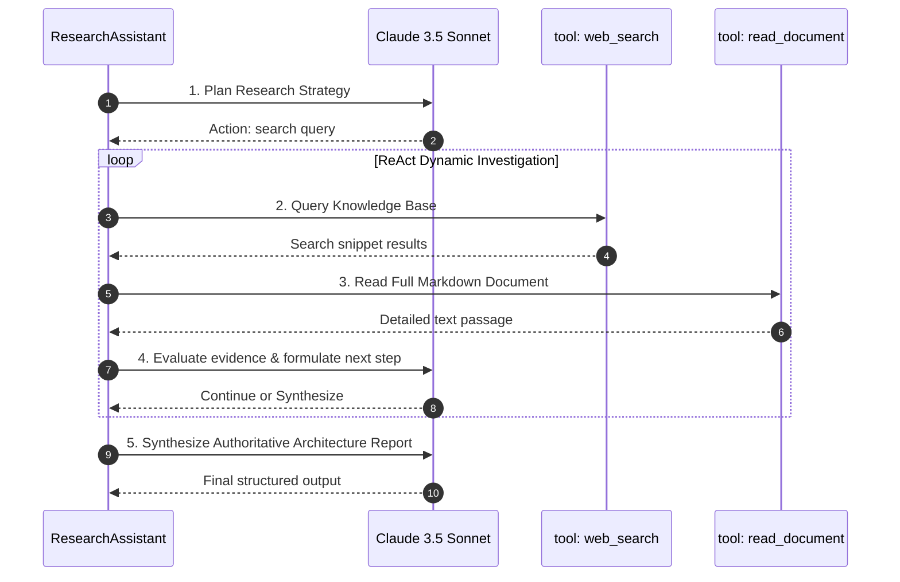
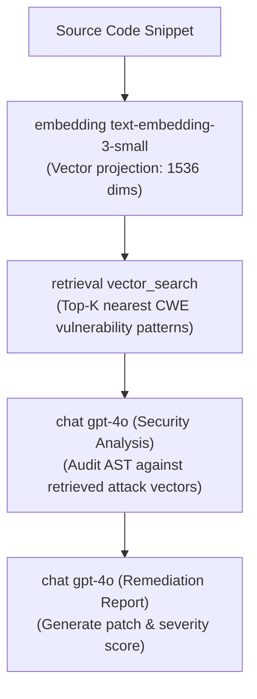
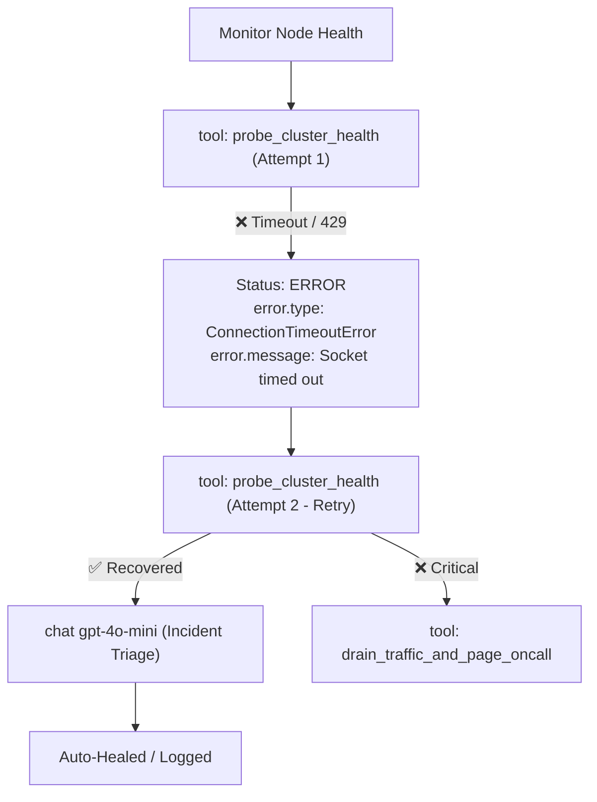
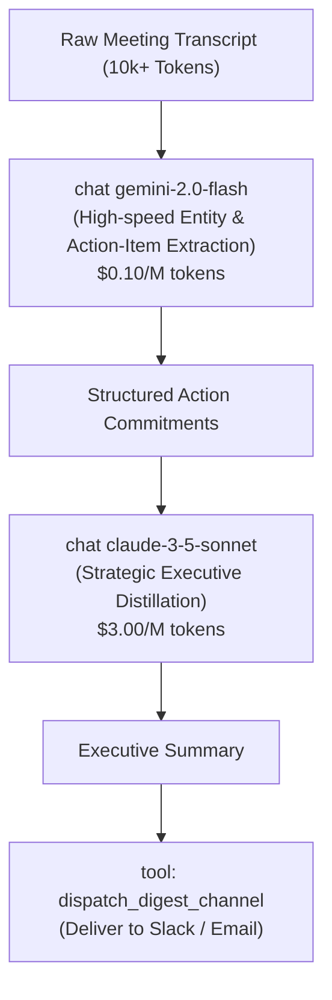
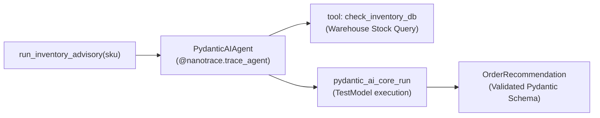
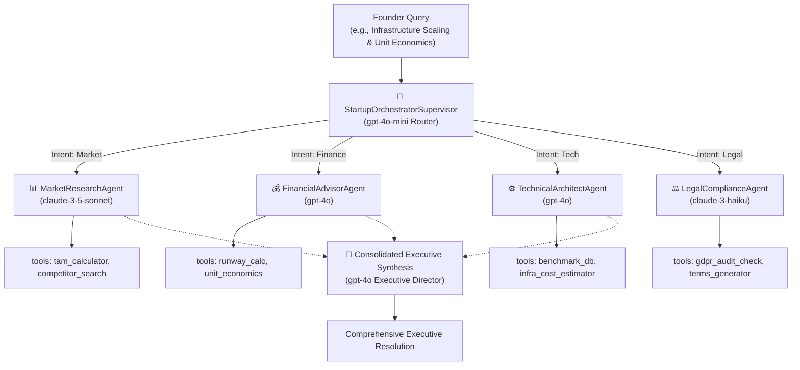
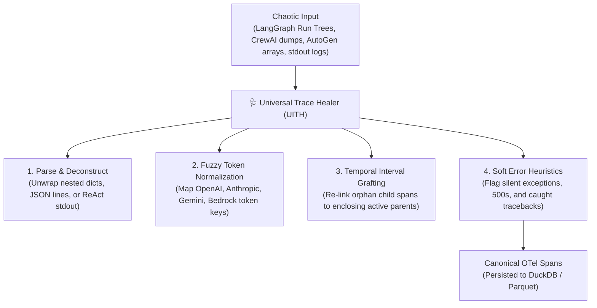
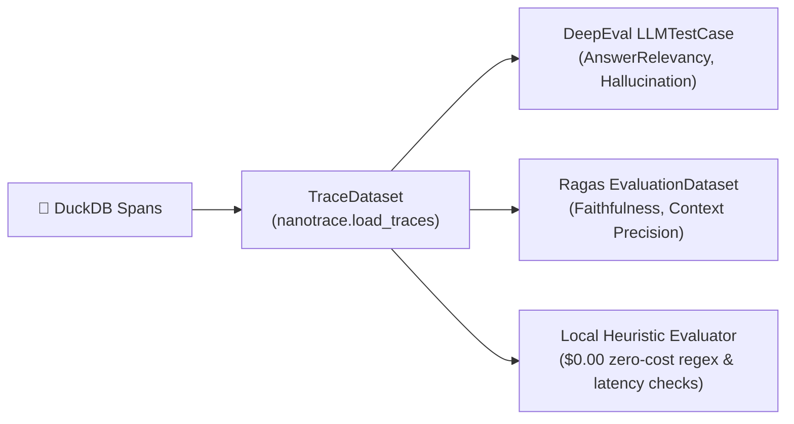

# ⚡️ NanoTrace: Complete Engineering User Manual & Architecture Guide

> **The DuckDB of AI Observability**  
> Ultra-low latency (< 15 µs), zero-cost ($0.00 cloud bills), framework-agnostic OpenTelemetry tracing and evaluation engine for AI agents and LLMs.

---

## Table of Contents
1. [Core Philosophy & Architecture](#1-core-philosophy--architecture)
2. [Quickstart in 3 Steps](#2-quickstart-in-3-steps)
3. [The 6 Foundational Agent Tracing Patterns](#3-the-6-foundational-agent-tracing-patterns)
   - [Pattern 1: Linear Multi-Stage Chain (Customer Support)](#pattern-1-linear-multi-stage-chain)
   - [Pattern 2: ReAct Tool-Calling Loop with Variable Depth (Research Assistant)](#pattern-2-react-tool-calling-loop)
   - [Pattern 3: Embedding & Vector Retrieval RAG (Code Review Auditor)](#pattern-3-embedding--vector-retrieval-rag)
   - [Pattern 4: Error Handling, Retries & SRE Triage (Data Pipeline Monitor)](#pattern-4-error-handling--sre-triage)
   - [Pattern 5: Heterogeneous Multi-Model Pipeline (Meeting Summarizer)](#pattern-5-heterogeneous-multi-model-pipeline)
   - [Pattern 6: Framework-Native Integration (PydanticAI)](#pattern-6-framework-native-integration)
4. [Multi-Agent Orchestrated Systems (Supervisor / Router)](#4-multi-agent-orchestrated-systems)
5. [Universal Trace Healer (UITH): Ingesting Chaotic Telemetry](#5-universal-trace-healer-uith)
6. [Trace-to-Eval Pipeline: DeepEval, Ragas & Local Heuristics](#6-trace-to-eval-pipeline)
7. [Local Web Dashboard & Analytics](#7-local-web-dashboard--analytics)
8. [CLI Command Reference](#8-cli-command-reference)

---

## 1. Core Philosophy & Architecture

Most AI observability tools force developers to send raw LLM prompts, tool arguments, and customer PII across the public internet to third-party hosted SaaS platforms (e.g. Datadog, LangSmith, Arize). This introduces **four major friction points**:
- 💸 **Steep Cloud Bills**: SaaS vendors charge \$30–\$50/seat plus per-span ingestion fees (\$30,000+/year at scale).
- 🔒 **Data Privacy Violations**: Egressing user prompts violates GDPR Article 28, HIPAA, and enterprise zero-data-retention mandates.
- 🐢 **Network Latency Overhead**: Remote HTTP telemetry exporters block agent event loops (adding 40–120ms per step).
- 🐳 **Docker Daemon Sprawl**: Self-hosted OpenTelemetry collectors require maintaining complex Docker Compose containers, ClickHouse clusters, and Jaeger daemons.

**NanoTrace solves this by embedding directly into your Python process—storing traces in an in-process DuckDB columnar lakehouse.**

### Architectural Dataflow Diagram



---

## 2. Quickstart in 3 Steps

### Step 1: Install NanoTrace
```bash
pip install nanotrace
# Or with UI dashboard support:
pip install "nanotrace[ui]"
```

### Step 2: Decorate Your Code
```python
import nanotrace
import time

# 1. Initialize local DuckDB trace engine
nanotrace.init(storage_path="./.traces/nanotrace.duckdb")

# 2. Decorate tool execution
@nanotrace.trace_tool(name="database_query")
def fetch_user_data(user_id: str):
    time.sleep(0.02)
    return {"user_id": user_id, "plan": "enterprise", "status": "active"}

# 3. Decorate agent logic
@nanotrace.trace_agent(name="AccountAdvisorAgent", agent_type="customer_success")
def run_advisor(user_id: str):
    user = fetch_user_data(user_id)
    
    # Trace LLM reasoning block with CNCF GenAI conventions
    with nanotrace.span("chat gpt-4o", attributes={"gen_ai.request.model": "gpt-4o"}) as sp:
        sp.set_attribute("gen_ai.system", "openai")
        sp.set_attribute("gen_ai.usage.input_tokens", 145)
        sp.set_attribute("gen_ai.usage.output_tokens", 52)
        sp.set_attribute("gen_ai.usage.total_tokens", 197)
        sp.set_attribute("gen_ai.usage.cost_usd", 0.000882)
        sp.set_attribute("gen_ai.completion", f"User {user_id} is on enterprise plan.")
        
    return f"Advice generated for {user_id}"

run_advisor("usr_9918")
nanotrace.flush()
```

### Step 3: Launch Local Dashboard
```bash
nanotrace ui --port 7777
```
Open `http://localhost:7777` in your browser to inspect waterfall timelines, token economics, and span hierarchies.

---

## 3. The 6 Foundational Agent Tracing Patterns

NanoTrace is engineered to trace every major agent design pattern. The `showcase/` package provides complete, production-grade implementations of each pattern:

```
showcase/
  ├── _simulator.py                  # Token estimation, pricing catalog, realistic latency
  ├── agent_01_customer_support.py   # Pattern 1: Linear Multi-Stage Chain
  ├── agent_02_research_assistant.py  # Pattern 2: ReAct Tool-Calling Loop
  ├── agent_03_code_review.py        # Pattern 3: Embedding & Retrieval RAG
  ├── agent_04_data_pipeline.py      # Pattern 4: Error Handling & SRE Triage
  ├── agent_05_meeting_summarizer.py # Pattern 5: Heterogeneous Multi-Model
  ├── agent_06_pydanticai_agent.py   # Pattern 6: PydanticAI Framework Integration
  ├── multi_agent_system.py          # Supervisor / Router Multi-Agent Council
  ├── healer_showcase.py             # Universal Trace Healer (UITH)
  └── run_all_and_validate.py        # Master test harness & 10-checkpoint validator
```

---

### Pattern 1: Linear Multi-Stage Chain

**Real-World Use Case**: Customer Support Ticket Classifier and Responder.  
**Characteristics**: Deterministic pipeline pairing a fast, low-cost classifier (`gpt-4o-mini`) with a nuanced, empathetic responder (`gpt-4o`).



#### Code Snippet
```python
@nanotrace.trace_agent(name="CustomerSupportAgent", agent_type="classifier_responder")
def handle_ticket(ticket_text: str):
    # Step 1: Rapid classification with gpt-4o-mini
    category = classify_ticket_llm(ticket_text)
    
    # Step 2: Comprehensive response generation with gpt-4o
    response = generate_response_llm(ticket_text, category)
    return {"category": category, "response": response}
```

---

### Pattern 2: ReAct Tool-Calling Loop

**Real-World Use Case**: Technical Research Assistant.  
**Characteristics**: Dynamic execution depth where the agent loops through **Reason $\to$ Act $\to$ Observe** cycles until sufficient evidence is compiled.



**What to Look For in NanoTrace**:
- Notice variable span tree depths: straightforward queries take 2 tool calls; complex queries automatically branch into 4+ tool calls.
- Parent-child span IDs preserve the sequential reasoning journey under one unified `trace_id`.

---

### Pattern 3: Embedding & Vector Retrieval RAG

**Real-World Use Case**: Automated Code Security Auditor.  
**Characteristics**: Captures OpenTelemetry GenAI retrieval semantic conventions (`gen_ai.operation.name="embedding"` and `"retrieval"`, `gen_ai.retrieval.documents`, `gen_ai.retrieval.query`).



#### Key Telemetry Attributes Recorded:
- `gen_ai.operation.name`: `embedding` / `retrieval`
- `gen_ai.retrieval.top_k`: `2`
- `gen_ai.retrieval.documents`: List of matched CWE vulnerability descriptors with similarity scores.

---

### Pattern 4: Error Handling & SRE Triage

**Real-World Use Case**: Production Data Pipeline SRE Monitor.  
**Characteristics**: Simulates real-world transient failures (TCP timeouts, replication lag, API rate limits 429). Shows how NanoTrace flags errors without breaking host execution.



**What to Look For in NanoTrace**:
- Spans with red `ERROR` badges in the timeline ruler.
- `error.type`, `error.message`, and `error.stacktrace` automatically populated in span details.

---

### Pattern 5: Heterogeneous Multi-Model Pipeline

**Real-World Use Case**: Executive Meeting Summarizer & Action Item Tracker.  
**Characteristics**: Pairs **Google Gemini 2.0 Flash** (for fast, low-cost extraction over massive transcripts) with **Anthropic Claude 3.5 Sonnet** (for strategic executive synthesis).



---

### Pattern 6: Framework-Native Integration (PydanticAI)

**Real-World Use Case**: Enterprise Logistics Supply Chain Inventory Check.  
**Characteristics**: Zero-code integration with modern typed agent frameworks (`pydantic-ai 2.x`). Uses PydanticAI's built-in `TestModel` to generate typed `BaseModel` outputs without external API keys.



---

## 4. Multi-Agent Orchestrated Systems

### The AI Startup Executive Council (Supervisor / Router Pattern)

The `showcase/multi_agent_system.py` module demonstrates a production-grade multi-agent hierarchy. A central **Supervisor Orchestrator** classifies incoming founder queries and coordinates four specialized domain agents:



### Distributed Context Propagation
NanoTrace automatically propagates the W3C `traceparent` (`00-{trace_id}-{span_id}-01`) and `gen_ai.conversation.id` across sub-agents via Python `contextvars`:
- **Single Trace ID**: Even when a query routes through 3 different specialist agents and 6 tool invocations, all spans belong to the same root `trace_id`.
- **Nested Waterfall**: The dashboard visualizes the orchestrator as the top-level parent, specialist agents as second-level nodes, and individual tools/LLM calls as leaf spans.

---

## 5. Universal Trace Healer (UITH): Ingesting Chaotic Telemetry

Real-world AI development is messy: teams frequently change frameworks, async thread pools lose context variables, and LLM APIs return inconsistent JSON schemas. 

NanoTrace's **Universal Trace Healer (UITH)** (`nanotrace.ingest()`) automatically normalizes non-standard logs into canonical CNCF OpenTelemetry spans:



### Ingestion Examples

#### 1. Ingesting LangGraph Run Trees:
```python
import nanotrace

nanotrace.init()

# Ingest nested child_runs from LangGraph / LangChain
nanotrace.ingest({
    "run_type": "chain",
    "name": "CustomerSupportGraph",
    "child_runs": [
        {"run_type": "llm", "name": "Classifier", "usage": {"input_tokens": 120, "output_tokens": 30}},
        {"run_type": "tool", "tool": "refund_tool", "inputs": {"order_id": 991}}
    ]
})
```

#### 2. Ingesting via CLI:
```bash
nanotrace ingest ./messy_agent_logs.json
```

---

## 6. Trace-to-Eval Pipeline: DeepEval, Ragas & Local Heuristics

Observability without evaluation is incomplete. NanoTrace provides a 1-line bridge to convert production traces directly into evaluation test cases:



### Code Example:
```python
import nanotrace

# Load recent traces into an evaluable dataset
dataset = nanotrace.load_traces(db_path="./.traces/nanotrace.duckdb", limit=100)

# 1. Convert to DeepEval
test_cases = dataset.to_deepeval()
# Ready for: evaluate(test_cases, [AnswerRelevancyMetric()])

# 2. Run Built-In Zero-Cost Heuristics (no LLM judge needed)
results = dataset.run_heuristics()
for res in results:
    if not res.passed:
        print(f"⚠️ Flagged span {res.span_id}: {res.reason}")
```

---

## 7. Local Web Dashboard & Analytics

Launch the embedded dashboard with a single command:
```bash
nanotrace ui --port 7777
```

### Key UI Capabilities:
- ☀️ / 🌙 **Light & Dark Themes**: High-contrast, clean developer interface.
- ⏱ **Millisecond Timeline Ruler**: Visual waterfall chart revealing bottlenecks and tool latency.
- 🔍 **Span Inspection Drawer**: View full prompt payloads, completion outputs, token usage, and exact USD costs.
- 📊 **Architecture & Infographic**: Built-in schematic diagrams and cloud migration guides.

### Sub-Millisecond SQL Analytics
Because NanoTrace stores traces in DuckDB, you can run instant analytical queries directly from Python or the CLI:

```python
import nanotrace

tracer = nanotrace.get_tracer()

# Query p95 latency by model
stats = tracer.query("""
    SELECT 
        gen_ai_request_model as model,
        COUNT(*) as total_calls,
        ROUND(quantile_cont(duration_ms, 0.95), 2) as p95_latency_ms,
        ROUND(SUM(gen_ai_cost_usd), 4) as total_spend_usd
    FROM spans
    WHERE gen_ai_operation = 'chat'
    GROUP BY gen_ai_request_model;
""")
print(stats)
```

---

## 8. CLI Command Reference

| Command | Description | Example |
|---|---|---|
| `nanotrace ui` | Start the local web dashboard | `nanotrace ui --port 7777` |
| `nanotrace stats` | Display summary metrics (tokens, spend, error rate) | `nanotrace stats` |
| `nanotrace query` | Run ad-hoc SQL queries on the trace store | `nanotrace query "SELECT * FROM spans LIMIT 5"` |
| `nanotrace export` | Export traces to compressed ZSTD Parquet | `nanotrace export ./traces.parquet` |
| `nanotrace ingest` | Ingest and heal external JSON/JSONL trace dumps | `nanotrace ingest ./agent_dump.json` |
| `nanotrace eval` | Run zero-cost heuristic evaluation on stored traces | `nanotrace eval --limit 50` |

---

## 9. Running the Showcase Suite

To execute all 6 agents, the multi-agent system, the healer engine, and run the 10-checkpoint validation suite on your machine:

```bash
# Run the complete showcase pipeline
python showcase/run_all_and_validate.py
```

Expected output:
```
================================================================================
  🏆 VALIDATION COMPLETE: 10/10 CHECKPOINTS PASSED (100% SUCCESS)
================================================================================
  • Total Traces Persisted : 46
  • Total Spans Persisted  : 242
  • Total Tokens Tracked   : 15,634
  • Total Cost Tracked     : $0.0625 USD
  • Error Rate Flagged     : 2.89%
  • Median Latency (p50)   : 28.05 ms
  • 95th Percentile (p95)  : 108.71 ms
  • Database File Location : ./.traces/showcase.duckdb (12.0 KB)
================================================================================
```
